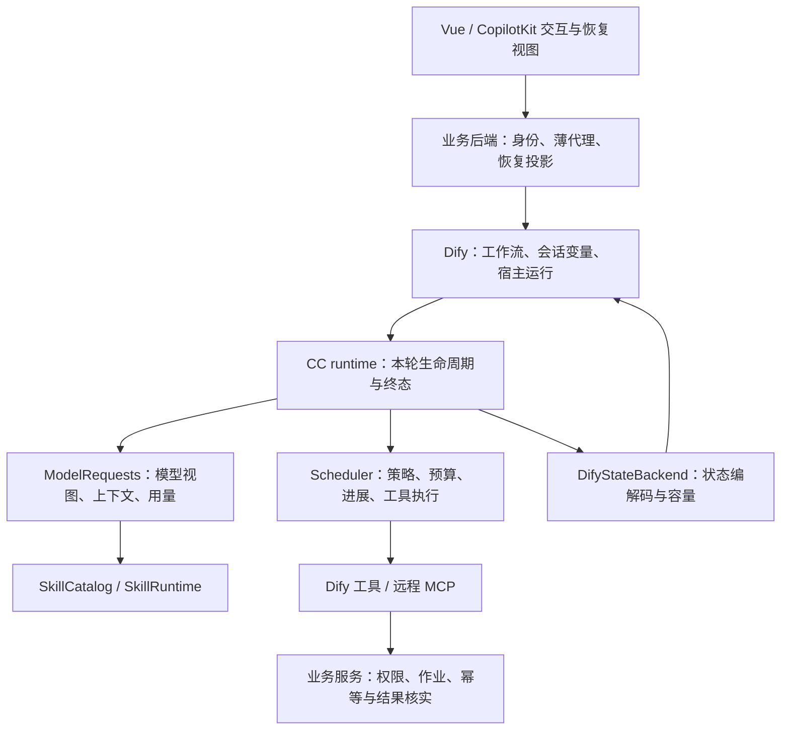

# CC Agent：Dify 环境下的 harness 架构评估与优化方案

日期：2026-10-28（Asia/Shanghai）。代码基线：`ea8f45a`。状态：评估完成，方案待实施。

后续实施决定：用户已授权实施，并明确删除工具/技能 allowlist、denylist；user ID 已由独立节点控制，不引入本报告第 7 项的身份代理。第 6 项中引入工具 allow/deny policy 的候选同样撤回。以下保留原始评估作为基线记录；实际实施范围见 [spec.md](spec.md)，最终验证见 validation.md。

本轮阅读后端运行时、状态、工具、技能、模型适配、前端流与恢复链路及既有 ADR；运行现有测试和纯内存探针。未修改运行代码，未连接生产 Dify、模型 provider 或业务 MCP。前序报告只用于了解已确认方向，下面的现状以当前代码为准。

## 结论与目标定位

**现有架构适合继续建设“Dify 托管、技能驱动的业务助手执行内核”。下一阶段收益最大的是完善执行契约、恢复语义和业务验证，而不是重新拆分 AgentLoop 或增加一套 agent 框架。**

这里的 harness 是围绕模型提供上下文组织、工具执行控制、用户中断、预算、结果验证和诊断的运行机制。当前已经具备其中的大部分基础结构，但“能跑完一轮”与“业务操作结果可核实、异常后可准确继续”之间仍有缺口。

沿用此前已确认取舍：Dify `agent_state` 是会话状态来源；技能优先由提示驱动；工具及 schema 全量提供；保留 AG-UI / Dify 两输出策略；回复结束前不接受新普通消息，不增加排队；刷新恢复已保存状态并明确未知结果；不承诺恢复同一条实时流。保留 ADR-0001/0002/0003，不恢复工作区、内部 shell、Memory 或第二套会话存储。

当前能力上限是用户请求驱动的多步执行与跨轮继续。进程崩溃后继续在途操作、后台长期自主执行、严格 exactly-once、跨设备实时补流，需要宿主持有运行生命周期及持久操作记录；它们不能由压缩后的聊天历史自然推导出来。若未来确实需要这些能力，应另行决定运行所有者，并重新讨论 ADR，而不是把它们隐含塞进插件。

## 已有结构的评价

| Module | 已有价值 | 本轮判断 |
| --- | --- | --- |
| `RunEnvironment` / `runtime` | 组装本轮配置、工具连接、技能和状态，统一两策略入口 | 保留；收敛终态与状态输出的顺序契约 |
| `ModelRequests` | 普通、续写、最终请求共用预算与一次溢出重试 | 已有较好的 Depth；在此统一调用用量与上下文构成统计 |
| `SerialToolScheduler` | 普通和批准恢复复用策略检查、执行和结果预算 | 保留串行；让执行进展及时可见，增加运行总预算 |
| `ToolCatalog` / `ToolAdapter` | 隔离内部、Dify、MCP 三种真实来源 | Seam 有实际价值；补充可信执行属性与规范化结果 |
| `SkillCatalog` / `SkillRuntime` | 目录、正文、资料分层；资格、定义变化和路径检查 | 保留；消除正文重复，控制活跃技能占用 |
| `DifyStateBackend` | 编码、容量保护、基于实际快照的摘要 | 应明确“准备状态输出”的 Interface；现在不具有平台提交确认或 CAS |
| `ProtocolRenderer` / `runStream` | 两种输出 Adapter 与原生/fallback 解释 | 保留；共享终态语义，不必替换 AG-UI |
| `conversationCoordinator` | 会话与 thread 映射、历史 ticket、过期结果处理 | 保留；在同一 ticket 下加入恢复快照 |
| Tasks | 保存目标分解、状态、依赖和 metadata | 适合工作进度；不能作为外部业务完成凭证或后台调度器 |

近期已完成的配对、尾部工具组保护、完整摘要替换、资料分页、状态超限失败和安全 `agent_failed` 等不重复列为待建能力。文件行数本身不是重构理由。

## 发现与建议

### 1. 流式参数拼接应先获得确定的输入契约（P1，已本地复现）

[model_adapter.py:54](/home/ygao/Desktop/work/cadre-system/cc_agent/cc_agent/core/model_adapter.py:54) 按 `id` 或 `index` 建立草稿；后续块省略 id 时不会归并回最初的 id 草稿。[model_adapter.py:552](/home/ygao/Desktop/work/cadre-system/cc_agent/cc_agent/core/model_adapter.py:552) 用字符串相等、前后缀启发式兼容累计与增量参数。

合成分块探针得到：

- 第一块有 `id=call1`，后续只有相同 `index`：最终只留下 `{"text":`，不能还原完整参数。
- 增量块 `{"value":`、`1`、`1`、`}`：得到 `{"value": 1}`，预期是 11。这是有效 JSON，单纯 JSON 解析校验不能发现值被改变。

这些证明特定输入下的确定性错误，**不证明当前生产 provider 一定发送这些分块格式**。上一轮已将真实 provider 取样列为后续事项，应优先完成。

方案：在 `DifyModelAdapter` 将 provider/SDK 输入归一化成明确的增量或快照事件；同一 tool index 和后到 id 维护稳定关联；快照采用替换语义，增量采用追加语义。无法区分时用经过采样验证的 provider 模式，不能继续靠内容猜测。畸形输入产生配对错误，不执行业务写操作。

验收：真实脱敏样本加合成样本，覆盖 id 仅首块出现、id 后到、重复字符、重复数字、嵌套 JSON、多调用交错、累计快照和截断 JSON；验证模型 Adapter 到工具实际参数的一致性。

### 2. Skill first 需要减少正文重复，并区分固定与动态上下文（P1，已本地复现）

[skill_catalog.py:73](/home/ygao/Desktop/work/cadre-system/cc_agent/cc_agent/core/skill_catalog.py:73) 把完整正文放入 active record 的 `summary`；[prompt_builder.py:99](/home/ygao/Desktop/work/cadre-system/cc_agent/cc_agent/core/prompt_builder.py:99) 每次将其放入 system prompt；[loop.py:355](/home/ygao/Desktop/work/cadre-system/cc_agent/cc_agent/core/loop.py:355) 又把同一正文作为内部 user message 注入历史。真实 AgentLoop 加 fake 模型探针确认第二次请求出现两份正文，分别在 system 和 user 消息。

此外，`static_context_tokens` 包括 system prompt 中的 Tasks、active skills、附件目录；这些内容具有动态生命周期。当前将其一并视作不可压缩输入，对固定指令提前拒绝是正确的，但可能把已无关的旧技能也变成不可释放成本。

方案：由 `ModelRequests` / `PromptBuilder` 形成唯一模型视图。保留技能激活记录、定义摘要和完整性标记；每次请求只注入一份必要正文；历史中的激活记录保持简短。给活跃技能和 Tasks 明确投影规则：优先当前未完成任务和相关技能，旧技能可退出当前上下文，但以后仍能重新加载。不能把截断正文标成完整，也不能丢弃待处理中断或破坏工具结果配对。

将预算拆成固定指令、全量工具 schema、技能目录、活跃技能、任务/附件、摘要、近期消息、最新工具结果。先做分项统计和去重；具体阈值依据真实会话分布确定。保持工具全量暴露，保持提示驱动，不新增 skill gate。

验收：同一正文只出现一次；定义更新和保存裁剪后仍可重载；新结果首次消费前不丢；长会话切换任务后能释放不相关技能成本；业务成功率不下降。

### 3. 运行结束、状态写回和业务结果应分别表达（P1，代码及探针确认）

[state_backend.py:78](/home/ygao/Desktop/work/cadre-system/cc_agent/cc_agent/core/state_backend.py:78) 的 `commit(expected_revision=...)` 只编码输入快照；两个基于 revision 7 的调用都会返回 revision 8 / persisted=true，没有共享存储比较。[state_variable.py:224](/home/ygao/Desktop/work/cadre-system/cc_agent/cc_agent/core/state_variable.py:224) 的 persisted 来自编码成功。它们都不能证明工作流的变量赋值节点已经完成。

[runtime.py:399](/home/ygao/Desktop/work/cadre-system/cc_agent/cc_agent/core/runtime.py:399) 先输出运行结束，再输出 `agent_state` 变量；宿主真正写回发生在插件之外。模型错误也可以作为带 `finish_reason` 的正常返回值结束循环，因此不能仅按 `RUN_FINISHED` / `agent_finished` 事件名判断业务成功。

方案：在现有结果契约中区分三组事实：运行状态（完成、等待用户、失败、预算耗尽）、状态交付阶段（编码就绪、输出、经读回验证）、外部操作结果（成功、失败、未执行、未知）。保留兼容字段但明确其含义；不直接把 `persisted` 改名导致旧消费端失效。将 `expected_revision` 明确为 previous revision，除非真正实现原子比较。状态输出尽量先于 UI 完成信号，仍不能据此承诺平台写回。

优先通过 Dify 工作流样例和验收验证“插件输出 → 变量赋值 → 下一轮读回”的真实链路。若需要 UI 确认，读取 Dify 会话变量并核对 run_id/revision。前端禁止并发只覆盖当前页面；对同会话多标签或 API 并发，应先验证 Dify 行为。若应用确实允许该入口，再由可信宿主做同会话执行互斥/忙碌拒绝，不增加队列，也不以本地 revision 伪装并发保护。

还有一个 Locality 问题：`RunEnvironment` 用自己的 backend 加载，而 [runtime.py:474](/home/ygao/Desktop/work/cadre-system/cc_agent/cc_agent/core/runtime.py:474) 保存时重新创建 `DifyStateBackend`。直接复用同一本轮实例即可，不需要再增加一层存储框架。

### 4. 刷新恢复和停止需要可核实的结果（P1，代码确认，生产行为待验证）

[DifyAgUiAgent.ts:280](/home/ygao/Desktop/work/cadre-system/cc_agent/copilotkit-dify/src/cc-assistant/lib/DifyAgUiAgent.ts:280) 只加载聊天消息，随后清空 `pendingInterrupt`；后端支持恢复，并不意味着刷新后 UI 能重新展示待回答卡片。文本回答可能仍触发后端隐式恢复，但不能替代完整交互恢复。

[DifyAgUiAgent.ts:445](/home/ygao/Desktop/work/cadre-system/cc_agent/copilotkit-dify/src/cc-assistant/lib/DifyAgUiAgent.ts:445) 发起 stop 后吞掉错误并 abort；[difyTransport.ts:342](/home/ygao/Desktop/work/cadre-system/cc_agent/copilotkit-dify/src/cc-assistant/lib/difyTransport.ts:342) 不检查 HTTP 状态。`runStream.finish()` 只关闭开放消息，也没有建立“流已结束但缺少可信终态”的显式恢复路径。

方案：将恢复动作收敛到现有 conversation ticket 下：加载历史，同时读取可信的恢复摘要（run_id、revision、pending question、最近终态）。可由宿主读取 Dify `agent_state` 后解码并仅投影 UI 必要字段，避免完整历史、授权和业务参数全部发回浏览器。不得把只读摘要作为新的恢复权威。Dify 1.15.0 源码确有读取会话变量的接口；部署 app mode、权限与工作流映射仍需实测。[Dify 1.15.0 会话变量入口](https://raw.githubusercontent.com/langgenius/dify/1.15.0/api/controllers/service_api/app/conversation.py)

停止流程区分“已请求停止”“客户端停止接收”“服务端确认状态”“外部操作结果未知”。检查 stop 返回只解决请求失败识别，不能证明远程 MCP 副作用被取消。Dify 1.15.0 的入口调用宿主 `AppTaskService.stop_task`，插件内没有与之接通的取消信号；取消能否传到 SDK/provider/远程工具应故障注入验证。[Dify 1.15.0 stop 入口](https://raw.githubusercontent.com/langgenius/dify/1.15.0/api/controllers/service_api/app/completion.py)

验收：待确认后刷新、恢复读失败、错 promptId、A→B→A、工具中途断流、stop 401/500、成功响应但工具结果不可核实；分别验证 UI 状态和下一轮行为。没有证据时不显示业务已取消，也不自动重放未知写操作。

### 5. 工具调度应同时控制执行总量和提供及时进展（P1）

[tool_scheduler.py:37](/home/ygao/Desktop/work/cadre-system/cc_agent/cc_agent/core/tool_scheduler.py:37) 执行整批后才返回结果；[loop.py:339](/home/ygao/Desktop/work/cadre-system/cc_agent/cc_agent/core/loop.py:339) 才开始渲染。探针顺序为 `execute:a → execute:b → consume:a → consume:b`。慢工具 B 会延迟 A 的结果显示；一开始输出所有工具调用也不等于所有工具都已开始执行。

配置提供迭代数、重复调用、连续错误和上下文上限，MCP 有请求超时；尚无统一的总耗时、工具总调用数、全部模型调用用量预算。一次模型返回很多不同调用，可以在一轮内消耗很长时间。`maximum_iterations=8` 也不等于最多八次模型调用，因为还存在续写、最终请求、压缩和恢复重试。

方案：保留串行调度，先增加执行开始/完成的及时进度通知，并明确 queued 与 executing。最终模型 observation 仍可以在整批结束后应用批次预算；不要为及时展示而破坏当前批次预算或再次转发 Dify 产物。若以后将结果改成逐项生成，需要先定义增量批次预算分配规则。

在现有 loop/requests/scheduler 共享一个本轮预算对象，统计真实模型调用、工具调用、耗时和 token；包括恢复调用及摘要调用。每个新调用前检查剩余预算，并给收尾和保存预留额度。对同步 Dify SDK 调用只能先承诺协作式检查，不能用后台线程包装 timeout 后声称外部执行已经停止。用业务 job_id + 状态查询承载长导出，插件不持续睡眠轮询；下一用户轮次继续查询。

### 6. 策略配置与业务操作契约要明确归属（P1/P2，产品取舍）

`ToolGuard` 和 `UserInterrupts` 支持 allow/deny/confirmation，但 [config.py:87](/home/ygao/Desktop/work/cadre-system/cc_agent/cc_agent/core/config.py:87) 的公开解析不提供这三项；[test_core_strategy_contract.py:191](/home/ygao/Desktop/work/cadre-system/cc_agent/cc_agent/tests/test_core_strategy_contract.py:191) 明确测试忽略它们。这是有意收缩的既有契约，不能当成无意遗漏恢复旧参数。

若业务需要执行前强制确认，建议显式设计由应用维护的工具 policy，复用现有 scheduler 和 resume 路径；若业务服务已经承担全部确认/授权，插件文档就应明确它提供的实际能力。AG-UI 可以用现有交互卡片；Dify 原生入口必须另行约定可用交互，不能悄悄注入 AG-UI `UserPrompt`。无论何种选择，用户批准都不绕过策略检查和业务鉴权。

`ToolSpec` 当前没有副作用、幂等、重试、核实方式等可信属性。外部异常已正确标记 unknown，但目前主要依赖模型阅读提示避免重试。未来接入写工具时，应由业务服务提供 operation_id / 幂等键和查询结果接口；一次业务操作的幂等键应跨重试稳定，不能简单使用每次重新生成的 run_id。插件保留短引用，服务端持有业务事实；本轮内可阻止已知未知结果的盲重试。崩溃前未持久化的状态仍必须靠服务端操作记录核实。

MCP annotations 可以辅助描述，不能作为不可信服务自授权限的依据；具体策略由应用配置或已验证服务契约决定。[MCP Tools 规范](https://modelcontextprotocol.io/specification/2025-11-25/server/tools)

### 7. 生产接入需要可信身份入口（生产条件成立时 P0）

前端 README 明确采用浏览器直连 Dify，并要求传入应用 API key；[difyTransport.ts:305](/home/ygao/Desktop/work/cadre-system/cc_agent/copilotkit-dify/src/cc-assistant/lib/difyTransport.ts:305) 从浏览器发送 key 和 user。这是仓库中的实际接入方式；本轮未核实生产是否另有网关。

如果生产照此接入，建议复用业务后端提供薄代理：应用 key 留在服务端，从已验证登录态生成 user/工号和业务凭证，检查会话归属，代理 SSE、历史、上传、停止和恢复摘要。禁止浏览器覆盖可信身份；业务 MCP 继续验证 token 与工号的绑定。Dify 的 user 是调用方传入的身份标识，平台不认证该值；一个应用 key 服务多个终端用户。[Dify 身份说明](https://docs.dify.ai/en/api-reference/guides/end-user-identity)；官方也明确要求 key 只用于后端调用。[Dify API 入门](https://docs.dify.ai/en/api-reference/guides/get-started)

该薄代理不持有第二份 agent_state，不引入会话数据库或后台 agent 平台；可以同时承接恢复摘要与请求身份关联。若生产已有等价措施，验证后标为已满足。

### 8. 从“流程通过测试”推进到“业务完成有证据”（P1/P2）

当前已有大量契约测试和模型/工具耗时、压缩统计，不能说没有可观测性；缺口在跨 Dify task、plugin run、tool call、业务 operation 的关联，以及真实任务质量评估。

方案分两部分：

- 结构化诊断沿用 Dify/现有日志通道，记录关联 ID、阶段、用量、状态字节数、截断/压缩原因、工具 outcome；默认记录长度、计数和安全错误码。当前模型 INFO 摘要含消息 preview（`model_adapter.py:718`），应评估业务数据暴露，默认移除正文 preview，脱敏调试样本按需保存。不把完整 trace 塞进 190KB 状态。
- 对每个重点应用技能建立少量端到端业务场景：触发条件、关键步骤、产物、验证方式、失败恢复；Task metadata 可以携带短的 evidence/job 引用，但 Task 标成 completed 本身不构成证据。确定性业务检查由外部工具完成，技能指导模型核实；不为所有聊天增加强制任务或通用 critic 模型。

评估分三层：纯内存契约回归；Dify SDK/provider 脱敏流回放；真实业务工具的受控集成场景。指标包括业务成功率、证据完整率、技能正确加载率、参数有效率、未知结果误重试次数、恢复成功率、总模型调用数、token 和 p95 时延。先采基线，再决定具体阈值。兼容性矩阵覆盖生产 1.15.0 和宣称支持的最低 Dify 版本；不能用本机 SDK 测试替代最低 1.7.0 的验证。

## 建议的目标结构

绝大多数都是现有 Module。优先深化现有 Interface：让“正确准备模型请求”“安全执行一批调用”“准确结束一次运行”“恢复一个会话”各自隐藏内部复杂度。无需先引入通用事件总线、DAG 引擎、插件中间件体系或多 agent 调度。

## 实施顺序与完成条件

| 阶段 | 交付 | 完成条件 | 相对工作量 |
| --- | --- | --- | --- |
| A：调用正确性 | provider 流样本、参数拼接修复；技能模型视图去重；跨层请求 ID | 参数逐字节/语义一致；技能正文单份；既有回归通过 | 中 |
| B：运行与恢复 | 终态/保存/unknown 契约；停止响应处理；pending 恢复；及时工具进度；总预算 | 故障矩阵通过；刷新可继续中断；未确认操作不被误报成功或重放 | 中到大，依赖 Dify 联调 |
| C：业务完成 | 重点技能验收场景、证据引用、写工具幂等与核实契约 | 代表性业务任务的成功/失败/未知可判定；能关联到具体工具结果 | 中，包含外部服务协作 |
| D：维护成本 | 清理过时配置/描述；依赖与离线包瘦身；持续契约检查 | 依赖声明/锁文件/wheels 一致，双架构离线解析通过 | 小到中 |

若生产确实使用浏览器应用 key，可信身份入口在 A 阶段之前或并行完成，不等到业务写操作扩张后再处理。工具 policy 是否成为公开能力需明确产品选择，但 A/B 中不依赖它的工作可独立推进。

维护成本方面，`pyproject.toml` / `requirements.txt` 仍声明 pandas、openpyxl、python-docx、python-pptx、reportlab、Pillow 等；本轮检索运行 Python 源码未发现对应直接导入。`wheels/` 当前约 123MiB，但尚未测量可删除份额，也不能直接判定全部依赖可移除。先核对传递依赖、构建脚本和打包技能需求，再同步三个依赖来源及离线 wheels。manifest 仍有 Memory 描述，配置也保留所有模型 profile 指向同一模型等历史表面，可作为独立清理。不要因此恢复已删除能力或改变 Dify 最低兼容声明。

短期继续接受全量工具 schema、串行工具调用、Dify 状态容量和两种输出 Adapter 的成本。只有真实观测表明工具数量、延迟或产品运行要求已突破这些约束，才重新讨论动态工具发现、并行读工具或独立运行服务。

## 本轮验证与复现

- 后端：236 项 unittest 通过，13.052 秒。使用本机缓存 Python 3.12 和既有临时 runner 加载依赖，没有安装或改动依赖。日志：`/tmp/cc-agent-architecture-evaluation-backend.log`。
- 前端：40 个文件、186 项 Vitest 通过，4.54 秒。日志：`/tmp/cc-agent-architecture-evaluation-frontend.log`。
- [probes.py](/home/ygao/Desktop/work/cadre-system/cc_agent/.scratch/harness-architecture-evaluation/probes.py) 只操作内存，输出六个观察：公开策略配置为空、首块 id 的参数未归并、重复增量数字被吞、相同 previous revision 都编码成功、整批结果延后交付、技能正文双份。
- 复现命令：在仓库根目录执行 `python3 -B .scratch/harness-architecture-evaluation/probes.py`。探针不是生产性能数据，也未作为通过型回归测试加入套件；落地修复时再转为契约回归。
- 未运行生产故障注入、真实 provider 样本回放、业务导出或鉴权验证；未重复离线打包。源码审查能确定控制流和数据所有权，不能确认部署行为。现有测试通过不代表本报告列出的缺口已被覆盖。
