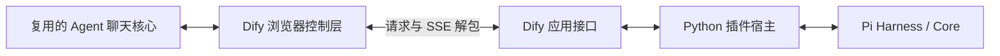

# Pi Agent 工作台：前端复用与 Dify 接入方向

日期：2026-10-29。用户已要求按推荐设计发布新规格；当前实施依据为 [Agent 工作台规格 v2](spec.md)，状态 ready-for-agent。本文记录选型依据，尚未完成客户端抽取、构建或真实 Dify 对接；旧版 AG-UI/全功能对齐要求已由新规格替代。

## 已确认的目标

用户要能看见 Agent 工作的 Web 界面：正在思考或回答、调用工具、加载技能、查看结果，以及需要用户回答时进行 AskUser。可采用社区已有的更常见、更完整的展示，不必复刻旧卡片、旧结构化回答格式或 CopilotKit 绑定。最初不按框架排除候选；用户进一步表达 Vue 复用偏好后，补查了真正的 Vue/Nuxt 客户端，现以 Leyline 的 Vue 聊天核心为首选。

- AG-UI/CopilotKit 和旧前端兼容不再是新 Pi Agent 的硬约束；旧 CC Agent 的现有前端继续独立可用。
- Tasks 等既有产品能力可按价值取舍，不要求为了功能对齐重新实现；默认不把独立 Tasks 系统与面板作为首版前置。
- Dify 没有可靠支持的常驻控制、会话分支等能力可以省略，不为模仿完整 Pi Web 工作台新增运行服务。
- 已选 Python Pi core/harness、Dify 当前会话模型/工具、Dify 跨轮状态、单环境一个完全离线 difypkg、生产 arm64/测试 amd64 的约束继续保留。
- 这一轮是探索与设计修订，未授权事实不能用“已支持”表述；目前没有可交付的新前端或完成验收的 Pi 插件。

## 官方与社区调查结论

官方旧 `pi-web-ui` 已在 2026-05-20 从仓库移除。当前官方支持 SDK、单向 JSON 输出和常驻 JSONL RPC；不存在可直接接上当前 Python Dify 插件的现行官方 Web 聊天包。[官方删除提交](https://github.com/earendil-works/pi/commit/b141e1fa2460868686ffd19c5d4ced743eee6c24)、[官方 RPC](https://github.com/earendil-works/pi/blob/556860a386a03113eca146abd9cbb08e9391b7fb/packages/coding-agent/docs/rpc.md)

社区详细核对了八个相关项目。以下 stars 为 2026-10-29 研究时读取 GitHub REST 的快照，仅说明本次搜索样本的关注度，不代表用户数、质量排名或全球穷尽排名。

| 项目 | stars 快照 | 对本项目的价值 |
| --- | ---: | --- |
| [agegr/pi-web](https://github.com/agegr/pi-web) | 7,880 | 本次样本最受关注；成熟的 Agent 聊天、工具流和 SSE 合并/重建思路；React/Next.js 客户端与原服务端 API 绑定较多 |
| [jmfederico/pi-web](https://github.com/jmfederico/pi-web) | 911 | 问卷交互参考与后备；Lit/Vite 核心有 props/回调，已有工具、技能、思考和问卷 |
| [spmurrayzzz/leyline](https://github.com/spmurrayzzz/leyline) | 5 | 补充 Vue 调查后的首选；Vue 3/Vite，已有工具、技能、思考及输入组件；需抽聊天容器与补问卷 |
| [xing-shuyin/pi-web-ui](https://github.com/xing-shuyin/pi-web-ui) | 344 | 可参考快照一致性和问卷；完整工作台含服务端、终端、SSH 等超出当前需求的功能 |
| [BlackBeltTechnology/pi-agent-dashboard](https://github.com/BlackBeltTechnology/pi-agent-dashboard) | 336 | 可参考执行轨迹与多端提示，完整部署需要它自己的双向 bridge 和服务 |

数据、其余四项及固定源码引用见[社区比较](community-web-comparison.md)。这些项目各自有浏览器协议，没有证据表明其中某一个是所有 Pi Web 客户端共用的标准。

## 推荐：复用聊天核心，替换 Dify 控制层

**首选抽取 Leyline 的 Vue 3 聊天核心，替换 Dify 控制层，补结构化 AskUser。** 固定源码基线为 a368c8b7590b88bb138c024b7dd8414b3dcc2a73，根许可 Apache-2.0。TranscriptEntry、LiveAssistantMessage、SessionComposer 已有 props/emits，工具/技能卡、思考、图片、聚合轨迹和输入交互可以复用；浏览器不运行 Agent。[Vue 补充研究](vue-web-options.md)、[消息组件](https://github.com/spmurrayzzz/leyline/blob/a368c8b7590b88bb138c024b7dd8414b3dcc2a73/src/components/TranscriptEntry.vue#L29)

复用仍需实际抽取：聊天组装在较大的 App 中，会话 composable 直接依赖原 REST/WS，Markdown 高亮还引用 Pi SDK 包内静态资源。应抽聊天容器、以 Dify controller 接管请求/历史/上传/停止/答复，并解耦构建资产；不搬入 Node/Pi 常驻后台、终端、Git、工作区、Electron 或 tracing 服务。[原控制层](https://github.com/spmurrayzzz/leyline/blob/a368c8b7590b88bb138c024b7dd8414b3dcc2a73/src/composables/useSessionWorkspace.js#L11)、[构建资源](https://github.com/spmurrayzzz/leyline/blob/a368c8b7590b88bb138c024b7dd8414b3dcc2a73/src/lib/transcript.js#L1)

Leyline 未提供完整多题 AskUser；需增加真正的 Vue 表单和安全问卷投影，不能只显示 JSON。jmfederico/pi-web 的完整问卷、草稿及历史答案作为交互参考，其集中 ChatView 也保留为备用候选，不同时维护第二套前端。两者都需要新的 Dify controller；选择 Leyline 是考虑真实组件覆盖与用户 Vue 偏好，不能用框架或热度代替验收。[问卷参考](https://github.com/jmfederico/pi-web/blob/762bbfdc5e7736fe90f33abd2e19e950d5f4d496/src/client/src/components/AskUserCard.ts)、[成本比较](vue-web-options.md#与-jmfederico-核心--dify-controller-的成本比较)

首道实施门是无原后台的静态 build 与消息/工具/技能/问卷事件回放。此处只有源码支持的适配判断，尚无成功抽取证据；实际复用保留各自许可、归属和必要 notices，发现硬耦合先记录可重复证据再调整选型。

`agegr/pi-web` 同时作为主要产品交互和 SSE 参考：消息/工具的起止保留，中间展示更新可合并，最终消息覆盖临时内容。它的 ChatWindow/useAgentSession 及输入组件分散调用原服务 API，不能只换 EventSource 地址就认为迁移完成。[事件合并](https://github.com/agegr/pi-web/blob/e533d9b3975f8a74b378d5007c92fdf4d15d3fba/lib/agent-event-stream.ts)、[会话 hook](https://github.com/agegr/pi-web/blob/e533d9b3975f8a74b378d5007c92fdf4d15d3fba/hooks/useAgentSession.ts)

## 首先保留的 Agent 体验

| 界面能力 | 数据来源与要求 |
| --- | --- |
| 思考、回答与输入状态 | Pi 消息/内容块生命周期；只显示模型实际提供的推理，缺失时显示普通运行状态 |
| 工具过程与折叠详情 | 真实开始、参数、可用的 partial、结束、结果/错误；按 toolCallId 关联，不把最终工具消息再显示为第二次执行 |
| 技能调用和已加载技能 | 当前宿主的技能激活/资料读取事实；可映射到社区已有技能卡与活动展示，不用虚构技能百分比 |
| 问卷和历史回答 | 单选、多选、自由输入等采用参考卡片可复用的交互；答复绑定当前问题，等待状态可恢复 |
| 压缩、上下文和用量 | 实际压缩操作及已知/估计用量；注明估计来源，不把上次 usage 当本次完整预算 |
| 产物与附件 | 由 Dify/授权工具返回的真实引用；延续去重及唯一交付原则 |
| 结束、等待、失败和断流 | 宿主完成状态提交后的终态为准；工具未知结果、客户端停止和业务取消明确区分 |

jmfederico 的技能展示已有真实实现：它把 `read .../SKILL.md` 投影为“已加载技能”行，也支持独立技能调用块。我们的应用技能可能来自 YAML/受限工具，因此应映射真实激活事实，不能机械识别任何 SKILL.md 字符串。[社区展示类型](https://github.com/jmfederico/pi-web/blob/762bbfdc5e7736fe90f33abd2e19e950d5f4d496/src/client/src/chatTypes.ts#L30)

Tasks 面板、完整分支树、运行中 steering、多机/项目管理、Git、终端、模型凭证管理和插件市场不构成上述核心体验的前置。业务 job/operation 的短引用仍可按业务需要保留，不等于另建 Tasks 系统。

## 传输与执行结构

普通展示可接近用户说的“Dify 外壳解包”：保留有限的 Pi 消息/工具事件，外面增加版本、run_id、顺序信息，宿主只输出允许的显示字段。问卷答复、历史、附件、停止与状态恢复仍是 Dify controller 的实际工作，不能用“透传”掩盖这些接口。

Python 0.6.0 的 `assistant_message_event`、`tool_call_id`、`content_index` 等与当前官方 TypeScript JSON 字段不同；settled/compaction/queue 语义也有差异。输出 Adapter 需一次明确映射，不能把任意 model_dump 宣称为官方 RPC 兼容。默认 LangChain adapter 的字段时序还需与本项目 Dify StreamFn 分开看。[官方与 Python 对照](official-web-events.md)

前端消息重建沿用 Pi 的基本规则：delta 更新所属内容块，最终 message_end 覆盖临时消息，工具生命周期和 toolResult 合并为同次执行。重复或过期事件不得改写另一会话；顺序号只是本轮关联，不等于服务器实现了断线重放或原子状态更新。

## Dify 载体的源码依据

已检查 Dify 1.15.0：Agent 插件 LOG 的 data 会进入 AgentLogEvent，再由 workflow response converter 放入 AgentLogStreamResponse.Data.data。因此在该路径可传输一般 JSON 显示事件，源码没有要求其内容必须是 AG-UI。[插件日志转换](https://github.com/langgenius/dify/blob/1.15.0/api/core/workflow/nodes/agent/message_transformer.py#L191)、[SSE 响应转换](https://github.com/langgenius/dify/blob/1.15.0/api/core/app/apps/common/workflow_response_converter.py#L908)

SDK 0.7.4 的 LogMessage.data 同样是 Mapping；现有前端已处理 agent_log 的 data.data 外壳。这说明继续利用既有承载路径有源码基础，不证明部署实例的聊天 API、节点配置及消费者已经通过新格式验收。

Dify 在运行中收集 agent_logs，同 ID 的条目更新已有记录，不同 ID 会增加记录。不能逐 token 无界保存全量消息快照；需合并显示更新、控制输出量并保留最终权威内容。具体日志 ID、节流和恢复规则应在实际传输验证后确定，不额外实现一个运行网关。

## AskUser 推荐的按轮语义

优先验证社区的“完整问卷结果 + 下一轮用户回答”做法：

1. AskUser 工具完成“提出问题”这一动作，返回可展示、可持久化的问卷结果，带稳定问题 ID。
2. 宿主保存当前待答投影；确定性阻止同批尾部真实工具，补齐配对结果，在批次末停止模型并输出等待状态。
3. 用户答复通过下一次 Dify 请求进入。答复字段在应用/节点上显式声明和映射，不假定未知 inputs 自动传给插件。
4. 校验当前问题 ID、题目/选项及已消费状态，将答案作为新用户消息加入 Pi 会话，再继续运行；不需要把提问工具的旧结果改写成答案。
5. 前端刷新时由 Dify 状态恢复待答问题；localStorage 可保存输入草稿，不能成为权威 pending 状态。

社区工具的 terminate 加“alone and last”提示不足以保证混合批次停止；其服务端还允许重复回答同一历史问卷。本项目需要保留确定性的批次 gate/停止与答复检查；不能直接继承为已经解决的 Dify 恢复契约。[社区工具](https://github.com/jmfederico/pi-web/blob/762bbfdc5e7736fe90f33abd2e19e950d5f4d496/src/server/sessions/askUserTool.ts)、[答复处理](https://github.com/jmfederico/pi-web/blob/762bbfdc5e7736fe90f33abd2e19e950d5f4d496/src/server/sessions/piSessionService.ts#L1946)

这是普通提问的语义，不能自动替代工具执行审批。业务授权、批准范围及 unknown 写操作仍按实际工具策略处理；并发/保存失败条件下不承诺单靠 Dify 变量实现恰好一次。

Dify 1.15.0 原生 Human Input 节点和公共表单 API 也已研究。AgentStrategy 的消息并不能直接请求原生暂停，接入需要额外图编排和再次调用插件；动态字段、版本及多次 AskUser 还有限制。因此先选择下一轮聊天，不把原生表单作为首版前置。[Dify AskUser 选项调查](dify-askuser-options.md)

## 后续实施前的验证顺序

1. **客户端抽取验证**：用固定源码基线保留成熟聊天组件及必要依赖，生成无需原 Node/WS 服务的静态页面，回放思考、工具、技能、问卷和最终结果。若抽取比源码判断更重，记录具体耦合再调整候选。
2. **Dify 事件穿透验证**：同一 fixture 经 SDK 日志输出、真实应用 SSE 与浏览器解包，核对字段、顺序、最终文本、历史及产物不重复。当前只有源码证据。
3. **Python Pi 展示映射**：实际调用 Dify StreamFn 与工具后验证内容块、工具 ID、partial/final、技能和压缩事实；不模拟不存在的精细进度。
4. **AskUser 跨轮闭环**：提出问题、保存、重建实例、刷新、正确/错误/重复答案与再次提问；验证暂停后的零新增模型请求及同批尾部零真实执行。
5. **按 v2 工单实施**：当前 [v2 规格](spec.md)及 [18 张实施票](ticket-plan.md)已发布，包含上述抽取/传输验收门；旧 17 票及其 US/A 编号归属 [v1 归档](ticket-plan-v1.md)，不直接照旧启动。

本次已完成官方/社区/平台源码研究和方向收敛，未运行外部社区客户端、抽取构建、新 Dify 传输或 AskUser 端到端测试；没有把 stars 或源码存在当作运行成功。
